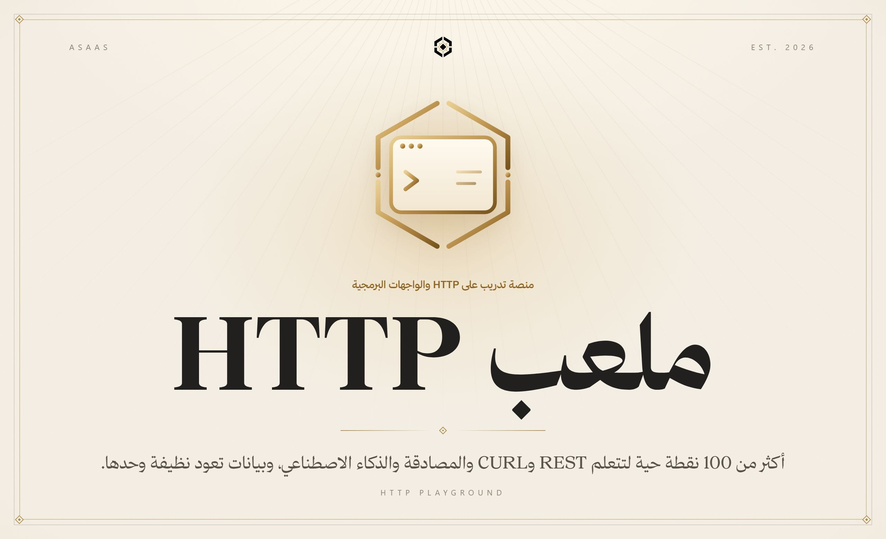
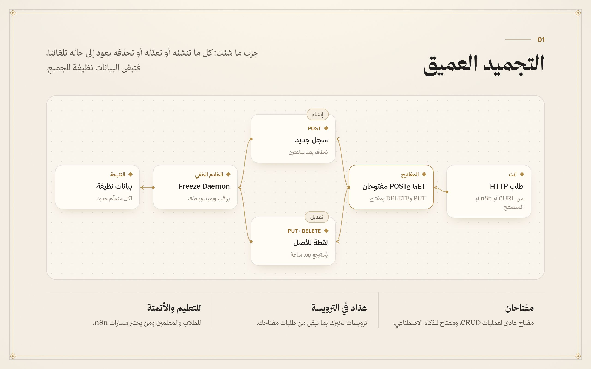
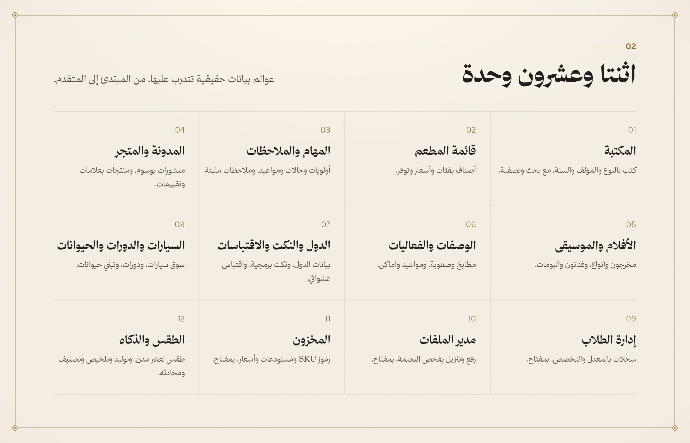
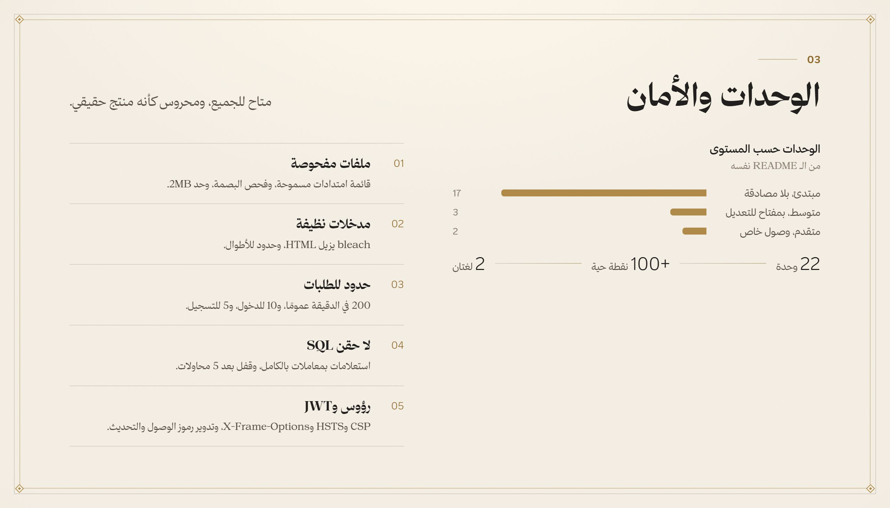
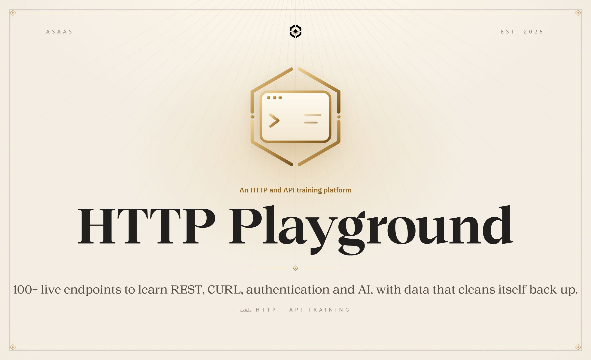
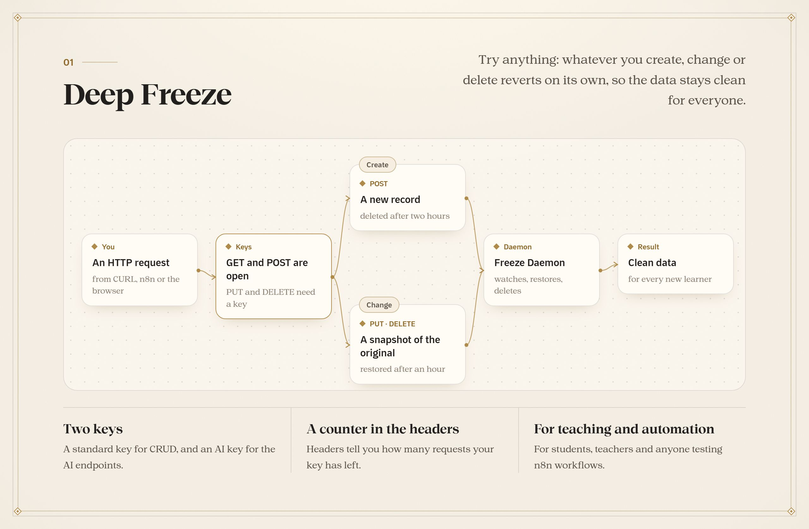
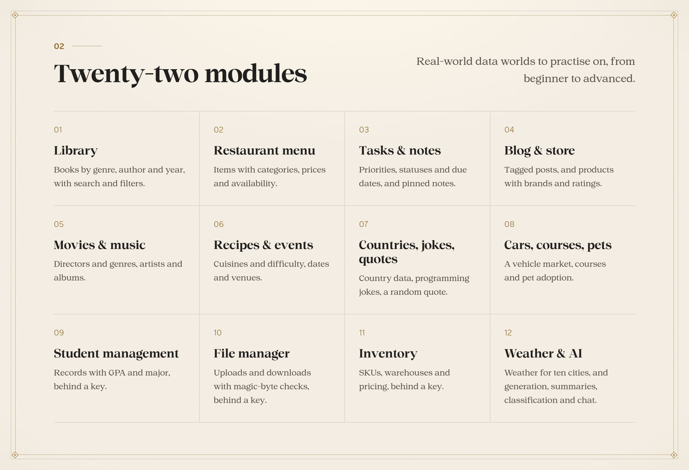
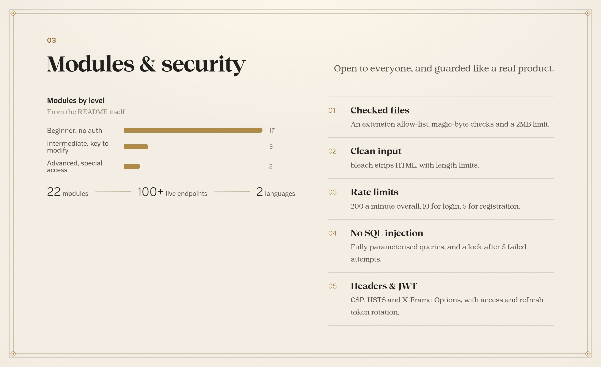

<a name="arabic"></a>

<p align="center"><b>العربية</b> · <a href="#english">English</a></p>



<br>

<div dir="rtl">

تعلّم HTTP والواجهات البرمجية لا يجب أن يبدأ بتشغيل خادم. ملعب HTTP يعطيك أكثر من 100 نقطة حية في 22 وحدة بيانات حقيقية، ونقاطًا للذكاء الاصطناعي عبر OpenRouter، ونظام «تجميد عميق» يعيد البيانات نظيفة وحدها، ومفتاحين للصلاحيات، وصفحات تفاعلية بأمثلة CURL، بالعربية والإنجليزية.

</div>

<br>







<br>

<div dir="rtl">

## التشغيل

```bash
pip install -r requirements.txt
cp env.example .env
python app.py
```

جرّب:

```bash
curl http://localhost:5050/api/books
```

الدليل الكامل بالإنجليزية في [`docs/GUIDE.md`](docs/GUIDE.md): كل الوحدات، ونظام المفاتيح، وورقة CURL، والنشر.

</div>

<p align="center"></p>

<a name="english"></a>

<p align="center"><a href="#arabic">العربية</a> · <b>English</b></p>



<br>

Learning HTTP and APIs shouldn’t start with spinning up a server. HTTP Playground gives you 100+ live endpoints across 22 real-world data modules, AI endpoints through OpenRouter, a Deep Freeze system that cleans the data back up on its own, dual access keys, and interactive pages with CURL examples, in Arabic and English.

<br>







<br>

## Running it

```bash
pip install -r requirements.txt
cp env.example .env
python app.py
```

Try:

```bash
curl http://localhost:5050/api/books
```

The full guide is in [`docs/GUIDE.md`](docs/GUIDE.md): every module, the key system, a CURL cheat sheet and deployment.

<p align="center"></p>

<p align="center"></p>

<p align="center">
  <sub>جزء من منظومة <b>أساس</b> · Part of the <b>Asaas</b> ecosystem</sub>
  <br>
  <sub>من تصميم وبناء <a href="https://github.com/AladdinAlynaey">علاء الدين اليناعي</a> · Designed and built by <a href="https://github.com/AladdinAlynaey">Alaadin Alynaey</a></sub>
  <br>
  <sub>© 2026 · جميع الحقوق محفوظة · All rights reserved</sub>
</p>
